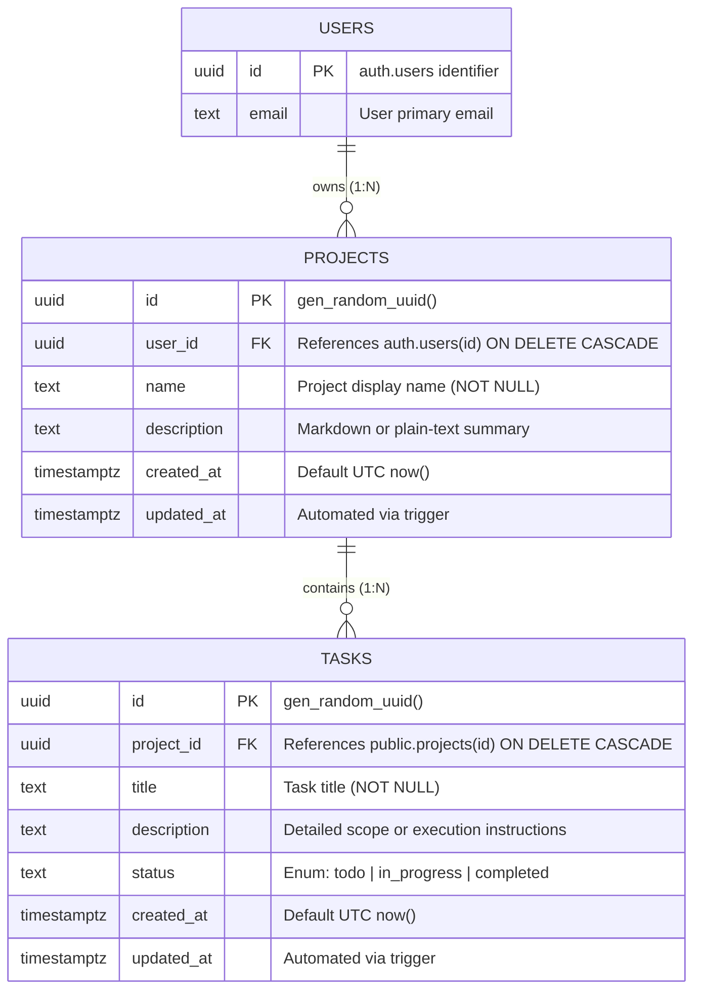

# Cognitive Workspace: Database Architecture & Backend Handover Specification

**Document Version:** 1.0.0  
**Target Audience:** Backend Engineers, Full-Stack Architects, Platform Integration Team  
**Architecture Domain:** PostgreSQL (Supabase), Row-Level Security (RLS), Data Access Contracts, RESTful APIs  

---

## 1. System Overview & Architectural Topology

The **Cognitive Workspace** platform manages AI-assisted research and agentic workflows organized around **Projects** and **Tasks**. 

### Multi-Tenant Zero-Trust Model
1. **Identity Provider:** Supabase Auth (`auth.users`) issues signed JSON Web Tokens (JWT) upon authentication.
2. **Database Engine:** PostgreSQL 15+ hosted on Supabase with Row-Level Security (RLS) active on all application tables.
3. **Data Access Layers:**
   - **Frontend Direct Access (Client/SSR):** Next.js connects via `@supabase/ssr` with the client's session JWT. All queries automatically pass through PostgreSQL RLS policies.
   - **Backend Service Access (FastAPI):** Backend services forward the caller's JWT to Supabase PostgREST or set local session config (`request.jwt.claim.sub`) so that **RLS is never bypassed** during user-scoped requests.
   - **Background Workers:** Asynchronous AI agent loops (e.g., LangGraph workers) operating outside user HTTP requests may use the `service_role` key strictly when user context is not available, adhering to auditing rules.

```mermaid
graph TD
    Client[Next.js Client / SSR] -->|Bearer JWT| SupabaseDirect[Supabase PostgREST]
    Client -->|Bearer JWT| BackendAPI[FastAPI Backend Service]
    BackendAPI -->|Forward User JWT| SupabaseClient[Supabase Python SDK / PostgREST]
    SupabaseDirect --> Postgres[(PostgreSQL Database)]
    SupabaseClient --> Postgres
    
    subgraph PostgreSQL Security Boundary
        RLS[Row Level Security Engine]
        RLS -->|auth.uid() = user_id| ProjectsTable[(public.projects)]
        RLS -->|Inherited Ownership via projects.id| TasksTable[(public.tasks)]
    end
```

---

## 2. Entity-Relationship Model & Data Dictionary

### 2.1 Entity Relationship Diagram



---

### 2.2 Table: `public.projects`

Stores top-level workspaces/initiatives created by authenticated users.

| Column | Data Type | Nullable | Default | Constraints & Foreign Keys | Description |
| :--- | :--- | :--- | :--- | :--- | :--- |
| `id` | `UUID` | `NO` | `gen_random_uuid()` | `PRIMARY KEY` | Globally unique identifier. |
| `user_id` | `UUID` | `NO` | *None* | `FK -> auth.users(id) ON DELETE CASCADE` | Owner user identifier. Cascades on account deletion. |
| `name` | `TEXT` | `NO` | *None* | Non-empty string | Human-readable name of the project. |
| `description` | `TEXT` | `YES` | `NULL` | None | Extended notes or project objectives. |
| `created_at` | `TIMESTAMPTZ`| `NO` | `timezone('utc'::text, now())` | None | Timestamp of project creation in UTC. |
| `updated_at` | `TIMESTAMPTZ`| `NO` | `timezone('utc'::text, now())` | Updated via `trigger_projects_updated_at` | Timestamp of last modification in UTC. |

---

### 2.3 Table: `public.tasks`

Stores granular action items, agent task loops, and development deliverables linked to a parent project.

| Column | Data Type | Nullable | Default | Constraints & Foreign Keys | Description |
| :--- | :--- | :--- | :--- | :--- | :--- |
| `id` | `UUID` | `NO` | `gen_random_uuid()` | `PRIMARY KEY` | Globally unique identifier. |
| `project_id` | `UUID` | `NO` | *None* | `FK -> public.projects(id) ON DELETE CASCADE` | Parent project identifier. Cascades on project deletion. |
| `title` | `TEXT` | `NO` | *None* | Non-empty string | Task summary / action item title. |
| `description` | `TEXT` | `YES` | `NULL` | None | Task specification, input parameters, or acceptance criteria. |
| `status` | `TEXT` | `NO` | `'todo'` | `CHECK (status IN ('todo', 'in_progress', 'completed'))` | Workflow state machine indicator. |
| `created_at` | `TIMESTAMPTZ`| `NO` | `timezone('utc'::text, now())` | None | Task creation timestamp in UTC. |
| `updated_at` | `TIMESTAMPTZ`| `NO` | `timezone('utc'::text, now())` | Updated via `trigger_tasks_updated_at` | Timestamp of last modification in UTC. |

---

### 2.4 Indexing Matrix & Performance Architecture

| Index Name | Target Table | Indexed Columns | Index Type | Optimization Rationale |
| :--- | :--- | :--- | :--- | :--- |
| `idx_projects_user_id` | `public.projects` | `(user_id)` | `BTREE` | Accelerates user-scoped project listings and RLS evaluation (`auth.uid() = user_id`). |
| `idx_projects_created_at` | `public.projects` | `(created_at DESC)` | `BTREE` | Fast reverse-chronological project list sorting. |
| `idx_tasks_project_id` | `public.tasks` | `(project_id)` | `BTREE` | Foreign key index; speeds up cascades and task filtering by parent project. |
| `idx_tasks_project_status`| `public.tasks` | `(project_id, status)` | `BTREE (Composite)`| High-frequency filtering pattern (e.g. `WHERE project_id = $1 AND status = 'in_progress'`). |
| `idx_tasks_created_at` | `public.tasks` | `(created_at DESC)` | `BTREE` | Reverse-chronological task timeline rendering. |

---

## 3. Row-Level Security (RLS) & Authorization Matrix

Row-Level Security is enabled on all tables:
```sql
ALTER TABLE public.projects ENABLE ROW LEVEL SECURITY;
ALTER TABLE public.tasks ENABLE ROW LEVEL SECURITY;
```

### 3.1 `projects` Policies (Direct User Ownership)
Users can only interact with projects where `user_id` equals `auth.uid()`.

```sql
-- SELECT: Only project owner can view
CREATE POLICY "projects_select_policy" ON public.projects
    FOR SELECT TO authenticated
    USING (auth.uid() = user_id);

-- INSERT: Project owner must match the caller's JWT
CREATE POLICY "projects_insert_policy" ON public.projects
    FOR INSERT TO authenticated
    WITH CHECK (auth.uid() = user_id);

-- UPDATE: Project owner can only update own projects
CREATE POLICY "projects_update_policy" ON public.projects
    FOR UPDATE TO authenticated
    USING (auth.uid() = user_id)
    WITH CHECK (auth.uid() = user_id);

-- DELETE: Only project owner can delete
CREATE POLICY "projects_delete_policy" ON public.projects
    FOR DELETE TO authenticated
    USING (auth.uid() = user_id);
```

### 3.2 `tasks` Policies (Inherited Relational Ownership)
The `tasks` table does not require duplicate `user_id` checks because authorization is **inherited directly from the parent project**. This prevents orphaned or cross-tenant task injection.

```sql
-- SELECT: Only tasks belonging to user's projects are visible
CREATE POLICY "tasks_select_policy" ON public.tasks
    FOR SELECT TO authenticated
    USING (
        EXISTS (
            SELECT 1 FROM public.projects p
            WHERE p.id = tasks.project_id
              AND p.user_id = auth.uid()
        )
    );

-- INSERT: User cannot add tasks to a project they do not own
CREATE POLICY "tasks_insert_policy" ON public.tasks
    FOR INSERT TO authenticated
    WITH CHECK (
        EXISTS (
            SELECT 1 FROM public.projects p
            WHERE p.id = tasks.project_id
              AND p.user_id = auth.uid()
        )
    );

-- UPDATE: Task modifications require ownership of parent project
CREATE POLICY "tasks_update_policy" ON public.tasks
    FOR UPDATE TO authenticated
    USING (
        EXISTS (
            SELECT 1 FROM public.projects p
            WHERE p.id = tasks.project_id
              AND p.user_id = auth.uid()
        )
    )
    WITH CHECK (
        EXISTS (
            SELECT 1 FROM public.projects p
            WHERE p.id = tasks.project_id
              AND p.user_id = auth.uid()
        )
    );

-- DELETE: Task deletion requires ownership of parent project
CREATE POLICY "tasks_delete_policy" ON public.tasks
    FOR DELETE TO authenticated
    USING (
        EXISTS (
            SELECT 1 FROM public.projects p
            WHERE p.id = tasks.project_id
              AND p.user_id = auth.uid()
        )
    );
```

---

## 4. Backend Service Contracts & CRUD Interface Definitions

The backend services should expose these standard RESTful contracts under the `/api/v1` namespace.

### 4.1 Endpoint Summary

| HTTP Verb | Path | Description | Required Auth |
| :--- | :--- | :--- | :--- |
| `GET` | `/api/v1/projects` | List caller's projects (supports pagination, search) | `Bearer <JWT>` |
| `POST` | `/api/v1/projects` | Create a new project for caller | `Bearer <JWT>` |
| `GET` | `/api/v1/projects/{project_id}` | Retrieve specific project details | `Bearer <JWT>` |
| `PATCH` | `/api/v1/projects/{project_id}` | Update project metadata | `Bearer <JWT>` |
| `DELETE` | `/api/v1/projects/{project_id}` | Delete project (cascades all tasks) | `Bearer <JWT>` |
| `GET` | `/api/v1/projects/{project_id}/tasks` | List tasks belonging to project | `Bearer <JWT>` |
| `POST` | `/api/v1/projects/{project_id}/tasks` | Create task inside project | `Bearer <JWT>` |
| `GET` | `/api/v1/tasks/{task_id}` | Retrieve specific task | `Bearer <JWT>` |
| `PATCH` | `/api/v1/tasks/{task_id}` | Update task title, description, or status | `Bearer <JWT>` |
| `DELETE` | `/api/v1/tasks/{task_id}` | Delete specific task | `Bearer <JWT>` |

---

### 4.2 Data Transfer Objects (Pydantic Models for FastAPI)

Your teammate can drop these Pydantic models directly into `backend/app/schemas/`:

```python
from datetime import datetime
from enum import Enum
from typing import Optional, List
from uuid import UUID
from pydantic import BaseModel, Field, ConfigDict

# ==============================================================================
# ENUMS
# ==============================================================================

class TaskStatus(str, Enum):
    TODO = "todo"
    IN_PROGRESS = "in_progress"
    COMPLETED = "completed"

# ==============================================================================
# PROJECT SCHEMAS
# ==============================================================================

class ProjectCreateRequest(BaseModel):
    name: str = Field(..., min_length=1, max_length=255, description="Project name")
    description: Optional[str] = Field(None, max_length=5000, description="Project summary")

class ProjectUpdateRequest(BaseModel):
    name: Optional[str] = Field(None, min_length=1, max_length=255)
    description: Optional[str] = Field(None, max_length=5000)

class ProjectResponse(BaseModel):
    id: UUID
    user_id: UUID
    name: str
    description: Optional[str] = None
    created_at: datetime
    updated_at: datetime

    model_config = ConfigDict(from_attributes=True)

class ProjectListResponse(BaseModel):
    items: List[ProjectResponse]
    total: int
    page: int
    size: int

# ==============================================================================
# TASK SCHEMAS
# ==============================================================================

class TaskCreateRequest(BaseModel):
    title: str = Field(..., min_length=1, max_length=255, description="Task title")
    description: Optional[str] = Field(None, max_length=10000, description="Task description")
    status: TaskStatus = Field(default=TaskStatus.TODO, description="Task status")

class TaskUpdateRequest(BaseModel):
    title: Optional[str] = Field(None, min_length=1, max_length=255)
    description: Optional[str] = Field(None, max_length=10000)
    status: Optional[TaskStatus] = None

class TaskResponse(BaseModel):
    id: UUID
    project_id: UUID
    title: str
    description: Optional[str] = None
    status: TaskStatus
    created_at: datetime
    updated_at: datetime

    model_config = ConfigDict(from_attributes=True)

class TaskListResponse(BaseModel):
    items: List[TaskResponse]
    total: int
```

---

### 4.3 Detailed Endpoint Contracts

#### `GET /api/v1/projects`
- **Query Parameters:**
  - `page` (int, default `1`)
  - `size` (int, default `20`, max `100`)
  - `search` (string, optional - filters by `name ILIKE %search%`)
- **Headers:** `Authorization: Bearer <JWT>`
- **Response `200 OK`:**
```json
{
  "items": [
    {
      "id": "e4a77914-1188-466d-8e47-cf4d207c81d2",
      "user_id": "848da66f-6ab3-470a-8bf8-2cbe7f80dbca",
      "name": "Financial Document Intelligence",
      "description": "Multi-agent extraction on SEC 10-K filings",
      "created_at": "2026-10-12T10:00:00Z",
      "updated_at": "2026-10-12T10:00:00Z"
    }
  ],
  "total": 1,
  "page": 1,
  "size": 20
}
```

#### `POST /api/v1/projects`
- **Request Body:**
```json
{
  "name": "Biomedical Literature Search",
  "description": "Dense vector retrieval pipeline with pgvector"
}
```
- **Response `201 Created`:**
```json
{
  "id": "c1f71465-9831-41fa-8692-a169b56f8f55",
  "user_id": "848da66f-6ab3-470a-8bf8-2cbe7f80dbca",
  "name": "Biomedical Literature Search",
  "description": "Dense vector retrieval pipeline with pgvector",
  "created_at": "2026-10-12T12:00:00Z",
  "updated_at": "2026-10-12T12:00:00Z"
}
```

#### `GET /api/v1/projects/{project_id}/tasks`
- **Path Parameters:** `project_id` (UUID)
- **Query Parameters:** `status` (optional: `todo`, `in_progress`, `completed`)
- **Response `200 OK`:**
```json
{
  "items": [
    {
      "id": "78749a94-4d83-4a11-b0be-0c2d3e911277",
      "project_id": "c1f71465-9831-41fa-8692-a169b56f8f55",
      "title": "Configure pgvector HNSW Index",
      "description": "Setup m=16 ef_construction=64 on pubmed embeddings",
      "status": "in_progress",
      "created_at": "2026-10-12T12:05:00Z",
      "updated_at": "2026-10-12T12:15:00Z"
    }
  ],
  "total": 1
}
```

#### `POST /api/v1/projects/{project_id}/tasks`
- **Path Parameters:** `project_id` (UUID)
- **Request Body:**
```json
{
  "title": "Implement Sliding Window Chunking",
  "description": "Validate 15% overlap across paragraphs",
  "status": "todo"
}
```
- **Response `201 Created`:**
```json
{
  "id": "f583bb22-3837-4f65-8b9a-4c2813133ff0",
  "project_id": "c1f71465-9831-41fa-8692-a169b56f8f55",
  "title": "Implement Sliding Window Chunking",
  "description": "Validate 15% overlap across paragraphs",
  "status": "todo",
  "created_at": "2026-10-12T12:30:00Z",
  "updated_at": "2026-10-12T12:30:00Z"
}
```

---

## 5. Supabase Client Integration & Backend Best Practices

### 5.1 How the Backend Should Initialize the Supabase Client
The backend must initialize the client with the **caller's Bearer token** so that PostgREST queries execute within PostgreSQL under the authenticated user's context.

#### Pattern: FastAPI Dependency Injection
```python
import os
from fastapi import Depends, Header, HTTPException, status
from supabase import Client, create_client
from supabase.lib.client_options import ClientOptions

SUPABASE_URL = os.environ["NEXT_PUBLIC_SUPABASE_URL"]
SUPABASE_ANON_KEY = os.environ.get("NEXT_PUBLIC_SUPABASE_ANON_KEY") or os.environ["NEXT_PUBLIC_SUPABASE_PUBLISHABLE_KEY"]

def get_user_supabase_client(authorization: str = Header(...)) -> Client:
    """
    Extracts Bearer token and instantiates a Supabase Client
    scoped to the user's RLS session.
    """
    if not authorization.startswith("Bearer "):
        raise HTTPException(
            status_code=status.HTTP_401_UNAUTHORIZED,
            detail="Missing or invalid Bearer authentication header."
        )
    
    token = authorization.split("Bearer ", 1)[1].strip()
    
    options = ClientOptions(
        headers={"Authorization": f"Bearer {token}"}
    )
    
    client = create_client(SUPABASE_URL, SUPABASE_ANON_KEY, options=options)
    # Inject auth token into postgrest headers
    client.postgrest.auth(token)
    return client
```

### 5.2 Why NOT to Use the Service Role Key for Standard CRUD
1. `SUPABASE_SERVICE_ROLE_KEY` bypasses all Row Level Security.
2. If your backend uses the service role key for CRUD operations, a bug in your `WHERE` filter will leak another user's projects or tasks.
3. By passing the caller's JWT:
   - Even if your endpoint executes `supabase.table("projects").select("*").execute()`, PostgreSQL **only returns rows belonging to that specific user**.
   - If an unauthorized user guesses a UUID and attempts `DELETE /api/v1/tasks/{uuid}`, the database rejects the query without touching any records.

### 5.3 Error Handling & Status Code Conventions

| Database Event / Error Code | Supabase / PostgREST Response | Backend HTTP Status Code | Recommended API Error Detail |
| :--- | :--- | :--- | :--- |
| **Row Not Found / Filtered by RLS** | `PGRST116` / Empty result `[]` | `404 Not Found` | `"Project or task not found."` |
| **Parent Foreign Key Missing** | `23503 foreign_key_violation` | `400 Bad Request` | `"Specified project_id does not exist or access denied."` |
| **Check Constraint Failure** | `23514 check_violation` | `422 Unprocessable Entity` | `"Invalid status. Must be 'todo', 'in_progress', or 'completed'."` |
| **Missing / Expired Bearer Token** | `PGRST301` / JWT expired | `401 Unauthorized` | `"Invalid or expired authentication session."` |
| **Duplicate Key** | `23505 unique_violation` | `409 Conflict` | `"Resource already exists with the given identifier."` |

---

## 6. Migration Execution Guide

To apply the database changes:
1. Open the Supabase Project Dashboard -> **SQL Editor**.
2. Run `supabase/migrations/20261012143000_relational_schema_rls_projects_tasks.sql`.
3. The script is **100% idempotent**: it safely creates tables, alters any legacy columns, sets constraints, creates indexes, configures updated_at triggers, and enables the granular RLS policies.

---

## 7. Step-by-Step Implementation Guide for Backend Teammate

Below is the concrete, step-by-step change set designed specifically for `backend/app/api/routes.py` and backend configuration.

### Step 1: Environment Variables
Ensure `.env` in `backend/` contains:
```env
SUPABASE_URL=https://<your-project>.supabase.co
SUPABASE_KEY=<your-anon-or-publishable-key>
```

### Step 2: Update Header Factory in `backend/app/api/routes.py`
Replace the static `get_supabase_headers()` with a dynamic header factory that captures the caller's JWT:

```python
from fastapi import Header

def get_supabase_headers(authorization: Optional[str] = None) -> dict:
    """
    Constructs PostgREST headers. If caller supplies Authorization Bearer token,
    forwards it to Supabase so PostgreSQL evaluates auth.uid() in RLS policies.
    """
    token = SUPABASE_KEY
    if authorization and authorization.startswith("Bearer "):
        token = authorization.split("Bearer ", 1)[1].strip()

    headers = {
        "apikey": SUPABASE_KEY,
        "Authorization": f"Bearer {token}",
        "Content-Type": "application/json",
    }
    return headers
```

### Step 3: Update Pydantic Schemas for Projects & Tasks
In `backend/app/api/routes.py`:

```python
class ProjectBase(BaseModel):
    name: str = Field(..., min_length=1, max_length=100)
    description: Optional[str] = Field(default="", max_length=5000)
    category: str = Field(default="Agentic Workflow")
    tags: List[str] = Field(default_factory=list)
    source_url: Optional[str] = None
    user_id: Optional[str] = None

class ProjectCreate(ProjectBase):
    pass

class Project(ProjectBase):
    id: str
    documents_count: int = 0
    status: str = "Active"
    created_at: str
    updated_at: Optional[str] = None

class TaskBase(BaseModel):
    project_id: str
    title: str = Field(..., min_length=1)
    description: Optional[str] = Field(default="")
    status: str = Field(default="todo")  # todo | in_progress | completed
    priority: Optional[str] = Field(default="medium")
    due_date: Optional[str] = None

class TaskCreate(TaskBase):
    pass

class TaskUpdate(BaseModel):
    title: Optional[str] = None
    description: Optional[str] = None
    status: Optional[str] = None
    priority: Optional[str] = None
    due_date: Optional[str] = None

class Task(TaskBase):
    id: str
    created_at: str
    updated_at: Optional[str] = None
```

### Step 4: Update Projects Endpoints with Token Forwarding
Update `list_projects` and `create_project` to accept `authorization: Optional[str] = Header(None)`:

```python
@router.get("/projects", response_model=List[Project], tags=["Projects"])
async def list_projects(authorization: Optional[str] = Header(None)):
    if SUPABASE_URL and SUPABASE_KEY:
        try:
            async with httpx.AsyncClient(timeout=6.0) as client:
                res = await client.get(
                    f"{SUPABASE_URL}/rest/v1/projects?select=*&order=created_at.desc",
                    headers=get_supabase_headers(authorization)
                )
                if res.status_code == 200:
                    return res.json()
        except Exception:
            pass
    return _PROJECTS_STORE

@router.post("/projects", response_model=Project, status_code=status.HTTP_201_CREATED, tags=["Projects"])
async def create_project(payload: ProjectCreate, authorization: Optional[str] = Header(None)):
    project_payload = {
        "name": payload.name,
        "description": payload.description,
        "status": "active"
    }
    if SUPABASE_URL and SUPABASE_KEY:
        try:
            async with httpx.AsyncClient(timeout=6.0) as client:
                headers = get_supabase_headers(authorization)
                headers["Prefer"] = "return=representation"
                res = await client.post(
                    f"{SUPABASE_URL}/rest/v1/projects",
                    headers=headers,
                    json=project_payload
                )
                if res.status_code in (200, 201):
                    created_list = res.json()
                    if isinstance(created_list, list) and len(created_list) > 0:
                        created = created_list[0]
                        _PROJECTS_STORE.insert(0, created)
                        return created
                elif res.status_code == 403:
                    raise HTTPException(status_code=403, detail="Forbidden: RLS violation on project creation.")
        except HTTPException:
            raise
        except Exception:
            pass

    fallback_project = {
        "id": f"proj-{uuid.uuid4().hex[:8]}",
        **project_payload,
        "created_at": datetime.utcnow().isoformat() + "Z"
    }
    _PROJECTS_STORE.insert(0, fallback_project)
    return fallback_project
```

### Step 5: Update Tasks Endpoints with Inherited Ownership
Update `list_tasks`, `create_task`, `update_task`, and `delete_task` to forward `authorization`:

```python
@router.get("/tasks", response_model=List[Task], tags=["Tasks"])
async def list_tasks(
    project_id: Optional[str] = None,
    task_status: Optional[str] = None,
    authorization: Optional[str] = Header(None)
):
    if SUPABASE_URL and SUPABASE_KEY:
        try:
            query_parts = ["select=*"]
            if project_id:
                query_parts.append(f"project_id=eq.{project_id}")
            if task_status:
                query_parts.append(f"status=eq.{task_status}")
            query_str = "&".join(query_parts) + "&order=created_at.desc"

            async with httpx.AsyncClient(timeout=6.0) as client:
                res = await client.get(
                    f"{SUPABASE_URL}/rest/v1/tasks?{query_str}",
                    headers=get_supabase_headers(authorization)
                )
                if res.status_code == 200:
                    return res.json()
        except Exception:
            pass

    results = _TASKS_STORE
    if project_id:
        results = [t for t in results if t.get("project_id") == project_id]
    if task_status:
        results = [t for t in results if t.get("status") == task_status]
    return results

@router.post("/tasks", response_model=Task, status_code=status.HTTP_201_CREATED, tags=["Tasks"])
async def create_task(payload: TaskCreate, authorization: Optional[str] = Header(None)):
    new_task = {
        "project_id": payload.project_id,
        "title": payload.title,
        "description": payload.description,
        "status": payload.status
    }
    if SUPABASE_URL and SUPABASE_KEY:
        try:
            async with httpx.AsyncClient(timeout=6.0) as client:
                headers = get_supabase_headers(authorization)
                headers["Prefer"] = "return=representation"
                res = await client.post(
                    f"{SUPABASE_URL}/rest/v1/tasks",
                    headers=headers,
                    json=new_task
                )
                if res.status_code in (200, 201):
                    created = res.json()[0]
                    _TASKS_STORE.insert(0, created)
                    return created
                elif res.status_code in (400, 403, 404):
                    raise HTTPException(
                        status_code=res.status_code,
                        detail="Cannot create task: parent project does not exist or access denied by RLS."
                    )
        except HTTPException:
            raise
        except Exception:
            pass

    fallback_task = {
        "id": f"task-{uuid.uuid4().hex[:8]}",
        **new_task,
        "created_at": datetime.utcnow().isoformat() + "Z",
        "updated_at": datetime.utcnow().isoformat() + "Z"
    }
    _TASKS_STORE.insert(0, fallback_task)
    return fallback_task
```

